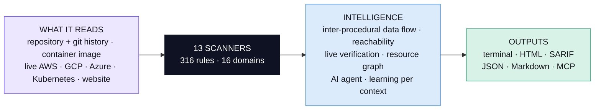
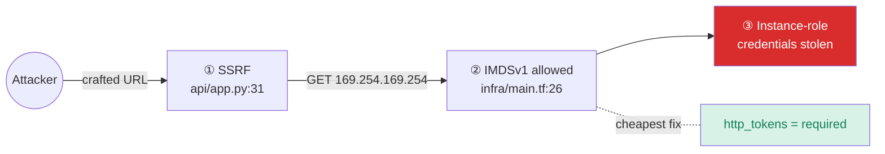
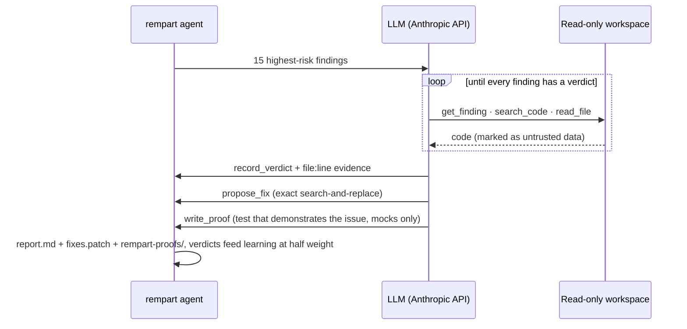

<p align="center">
  
</p>

<p align="center">
  <a href="LICENSE"></a>
  <a href="pyproject.toml"></a>
  <a href="tests"></a>
  <a href="docs/RULES.md"></a>
  <a href="docs/THREAT_CATALOG.md"></a>
  <a href="#-measured-not-claimed"></a>
  <a href="#-plug-it-into-your-ai-coding-assistant-mcp"></a>
</p>

<p align="center">
  <b>One scan across code, dependencies, container images, your live AWS, Google Cloud and Azure accounts, Kubernetes, data stores, CI/CD and AI agents.<br>
  Findings are correlated into attack paths, every result says how it was proven, an AI agent reviews the code behind them, and the tool learns from your triage.</b>
</p>

<p align="center">
  <a href="#-quick-start">Quick start</a> ·
  <a href="#-how-it-thinks">How it thinks</a> ·
  <a href="#-attack-paths">Attack paths</a> ·
  <a href="#-the-ai-verification-agent">AI agent</a> ·
  <a href="#%EF%B8%8F-coverage">Coverage</a> ·
  <a href="docs/THREAT_CATALOG.md">Threat research</a> ·
  <a href="learning/rempart-guide.pdf">Illustrated guide (FR)</a>
</p>

---

<p align="center">
  
  <br><sub>Real output on <code>examples/vulnerable-app</code>: six attack paths, five of them proven through the infrastructure that connects their pieces.</sub>
</p>

## ✨ Why Rempart

<table>
<tr>
<td width="33%" valign="top">

### 🧭 Thinks in chains
An SSRF is "high". IMDSv1 is "high". Together they are the **2019 Capital One breach**. Rempart builds a **resource graph** (Terraform references, compose services, Kubernetes objects, the images your repo builds) and only calls a chain proven when its pieces are connected, showing the route.

</td>
<td width="33%" valign="top">

### 🔬 Proves what it says
Every finding carries a **verification level**: pattern, data flow, imported dependency, live observation, live-verified secret, or AI review. CVEs are ranked by **real exploitation** (CISA KEV, FIRST EPSS), not CVSS alone.

</td>
<td width="33%" valign="top">

### 🧠 Gets sharper with use
Mark a result true or false and each rule's precision is recalibrated, **per kind of file**. Give the reason (`--because sanitizer:clean_html`) and the **whole class** of findings goes, in every later scan. Fixes you make and inline ignores count as evidence too, and `rempart learn --eval` replays your history to show whether learning actually ranks real issues higher. An **AI agent** reads the code to confirm or reject findings, and it can never close one. Only you can.

</td>
</tr>
</table>

## 🚀 Quick start

```bash
pipx install "rempart[all] @ git+https://github.com/Houssam2510/rempart"   # extras: [aws] boto3 · [ai] Anthropic SDK · [tui] Textual
```

| You want to… | Run |
|---|---|
| Scan a repository | `rempart scan .` |
| Scan, browse, triage and teach in an interactive terminal interface | `rempart tui .` |
| See every domain fire on a demo app | `rempart scan examples/vulnerable-app --offline` |
| Correlate code **and** production | `rempart scan . --aws --image myorg/api:latest` |
| Audit a container image, **no Docker needed** | `rempart image python:3.9-slim` |
| Audit your live AWS account (read-only) | `rempart cloud aws --profile prod` |
| Audit a live Kubernetes cluster | `rempart k8s --context prod` |
| Check whether leaked keys still work | `rempart scan . --verify-secrets` |
| Audit a website you own (passive) | `rempart web https://your-site.example` |
| Audit Google Cloud or Azure (read-only, via `gcloud` / `az`) | `rempart cloud gcp --project my-proj` · `rempart cloud azure` |
| Judge a PR only on what it adds | `rempart scan . --baseline origin/main --fail-on high` |
| Find secrets deleted from files but still in git history | `rempart scan . --git-history --verify-secrets` |
| Ignore build/test-only dependencies | `rempart scan . --prod-only` |
| Re-scan on every change, print only the difference | `rempart watch .` |
| Teach the reason, not just the verdict | `rempart triage <id> --fp --because sanitizer:clean_html` |
| See what it learned, and whether learning helps on your history | `rempart learn` · `rempart learn --eval` |
| Measure detection per domain on the labelled corpus | `rempart bench -v` |
| Let the AI agent verify, fix and write proof tests | `rempart agent .` |
| Measure the agent on labelled cases | `rempart agent-eval` |
| Gate CI on severity | `rempart scan . --fail-on high -f sarif -o rempart.sarif --also md:summary.md` |

The core needs only Python 3.11 and PyYAML. No account, no telemetry.

## 🖥️ Terminal interface

`rempart tui .` (needs the `[tui]` extra) runs the same scan as `rempart scan`, with a progress bar, then opens five views:

| View | Shows |
|---|---|
| **1 Overview** | score and grade in large digits, trend over past scans, severity and domain bars, **fix first** (proven paths with the cheapest place to break them, upgrades that close used or exploited advisories, proven high findings), attack paths. `Enter` opens the selected action. |
| **2 Findings** | domain and severity filters, search, a table that fits the terminal, and the selected finding with its code (highlighted line), evidence, how to fix and framework mappings |
| **3 Attack paths** | each chain drawn from the attacker to the impact, stage by stage, with the infrastructure route and the cheapest place to break it |
| **4 Dependencies** | the upgrade plan and every advisory of the selected package |
| **5 Learning** | the replay (does learning help?), the project knowledge, precision per rule and where its evidence came from |

| Key | Does |
|---|---|
| `1`…`5` · `ctrl+p` · `?` | switch view · command palette (every action by name) · keys |
| `t` · `f` · `a` | true positive · false positive · accepted risk, recorded as with `rempart triage` |
| `b` | false positive **because** `sanitizer:NAME` or `placeholder:VALUE`, then rescans: the whole class goes |
| `/` · `s` | search rule, path or message · cycle the minimum severity |
| `x` · `y` | open the finding in `$EDITOR` (or VS Code) at its line · copy `path:line` |
| `r` · `o` · `e` | rescan · toggle offline (no OSV / KEV / EPSS) · write `rempart-report.html` |

Verdicts, fixes and knowledge made in the interface teach the CLI too: it is the same history and the same `.rempart/knowledge.toml`.

## 🧩 How it thinks



| Layer | Example |
|---|---|
| **Data flow** | Values carry taint, sanitisation, constants and container contents through branches, loops and validation guards. Every Python function and method of the repository is **summarised** (parameter → return, parameter → sink, constant return), so a wrapper in `helpers/` returning `"bar"` is known to be safe and `run_tool(request.args["x"])` is reported at the call site with the sink in the other file. JS/TS: variables from `req.*`, `searchParams`, `request.json()`, and functions of the same file. |
| **Reachability** | `next@14.2.32 … your code calls the vulnerable function at app/page.tsx:12` vs `… imported, but none of the vulnerable functions is called` vs `transitive, not imported`. Dev-only packages drop one level. An **upgrade plan** gives the smallest version that fixes every advisory per package. |
| **Live verification** | A GitHub token found in `ci.sh` is checked against `api.github.com/user`. The verdict is `VERIFIED LIVE: GitHub user octo` (CRITICAL) or `revoked` (LOW). It covers 24 providers, including AWS STS through a stdlib SigV4 signer tested byte-for-byte against botocore. |
| **Correlation** | `CODE-SSRF` in `api/app.py` + `TF-EC2-IMDSV1` on `aws_instance.worker`, whose `user_data` runs the image built from this repo → `CHAIN-SSRF-TO-CLOUD-CREDENTIALS`, **linked**. Without that link it is reported one level lower as a co-occurrence. |
| **AI agent** | "False positive: `eval` only receives values from the constant `OPS` table; user input selects a key (`app.py:4,8`)." |
| **Learning** | IDOR rule: 35 % → 28 % after one false positive. Two false positives on `eval` in `scripts/` lower it there, not in `src/`. `--fp --because sanitizer:clean_html` teaches the data-flow engines (Python and JS/TS) that `clean_html()` sanitises XSS, so every finding behind it goes. A finding that disappears after a code change counts as confirmed; one that comes back is a **regression** and is raised one level. |

## 🧨 Attack paths



| Pattern | Links | Real-world reference |
|---|---|---|
| SSRF → cloud credentials | SSRF × IMDSv1 (Terraform or live) | Capital One, 2019 |
| Exposed data store | public port / DB × no auth or encryption | MongoDB wipe-and-ransom waves, 2026 |
| Untrusted CI → release | pwn request / script injection × publish power | TanStack, May 2026 |
| RCE → host | RCE-class bug or KEV CVE × privileged container, socket, hostPath | container escapes |
| Public BaaS table | missing RLS / open Firebase rules × client key in front-end | Supabase / Firebase leaks |
| Debug console exposed | debug mode × bind on 0.0.0.0 | Werkzeug console |
| XSS → session theft | XSS sink × script-readable tokens | session hijacking |
| Admin credentials exposed | `*:*` / AdministratorAccess × key leak path | account takeover |
| Worm propagation | install-time code × publish token | Shai-Hulud, 2025 |

## 🤖 The AI verification agent



```bash
export ANTHROPIC_API_KEY=...
rempart agent . --max-findings 15     # → rempart-agent-report.md + rempart-fixes.patch
rempart agent . --apply               # also write the fixes (review with git diff)
rempart agent-eval                    # agreement, true-positive retention, false-positive removal on a labelled corpus
```

For each finding it confirms, the agent writes a **proof-of-exploitability test** into `rempart-proofs/`: the framework's test client sends the malicious input and asserts the unsafe behaviour, with every side effect mocked. Rempart never runs it; you read it, run it, and it should fail once the fix is in. `rempart agent-eval` measures the agent on 9 bundled repositories (7 real issues, 5 traps the static layer cannot settle: allow-lists in helpers, sanitisers in other files, literal-only callers), so a model or prompt change is a measured change.

It uses the newest Opus-tier model available to your key, or the one set with `--model` / `REMPART_MODEL`. **Safe by construction**:

- 🔒 It reads only the files the scan discovered. There is no tool to execute code, reach the network or write.
- 🧱 Repository content is declared untrusted, a defence against prompt injection planted in comments or READMEs.
- ⏱️ The loop is bounded, and server-side refusal fallback keeps a declined request from aborting the run.
- ⚖️ Its verdicts never delete a finding. They count half in calibration and never override yours.
- 🧯 Before anything reaches the API, secrets are masked and credential files (`.env*`, keys, `*.tfstate`…) are never read ([SECURITY.md](SECURITY.md)).
- 🚧 `--apply` never writes CI files, Dockerfiles, lockfiles or `package.json` scripts (`--allow-sensitive-paths` to override). Proof tests are checked statically before they are saved (no network, no subprocess, no writes outside a temporary directory) and start with a warning header; a proof that fails the check is refused and never written.

It is tested against the real Anthropic Python SDK through a mocked HTTP transport, asserting the exact request bodies.

## 🔌 Plug it into your AI coding assistant (MCP)

```json
{ "mcpServers": { "rempart": { "command": "rempart", "args": ["mcp", "--root", "/path/to/your/projects"] } } }
```

The assistant can only scan inside the `--root` directories (default: the server's working directory, or `REMPART_MCP_ROOTS`), and `rempart_web_audit` only reaches **public** addresses: the host is resolved once, every address must be public (no private, loopback, link-local, cloud-metadata or reserved range), and the connection goes to that checked address, so a changing DNS answer cannot redirect it; redirects are checked at every hop.

Tools: `rempart_scan` · `rempart_finding` · `rempart_triage` · `rempart_web_audit` · `rempart_image_scan` · `rempart_rules`. Your assistant can scan, read details and record verdicts while it writes code.

What an assistant records is **evidence, not a decision**: `rempart_triage` stores its verdict with the source `ai_assistant`, at weight 0.5, in the scanned project only. It never closes a finding and never changes the severity that `--fail-on` reads: only verdicts from `rempart triage` (a person) do. A reason it gives (`because`) is stored as a proposal that a person accepts with `rempart learn --accept-proposals`.

## 🗺️ Coverage

<details open>
<summary><b>16 domains, mapped to current frameworks</b></summary>

| Domain | Highlights | Frameworks |
|---|---|---|
| 🧬 **Code** | SQL/NoSQL/command/code/template injection, XSS sinks, SSRF, path traversal, open redirect, deserialization, JWT `none`, weak crypto, mass assignment, CORS, uploads, ReDoS, Trojan Source, IDOR queue. Python AST + JS/TS/Svelte/Vue, Go, Java/Kotlin, PHP, Ruby, C#, C/C++ | OWASP A01–A10:2025, CWE Top 25 |
| 🔑 **Secrets** | 45 token formats, private keys, entropy-filtered literals, committed `.env`, **git history** of every branch; live checks for 24 providers | CWE-798 |
| 📦 **Dependencies** | 12 lockfile formats → OSV + KEV + EPSS, dev/prod scope, vulnerable-function reachability, upgrade plan, malicious releases, typosquats, dependency confusion, install scripts | A03:2025 |
| 🐳 **Images** | Registry pull without Docker, whiteout-aware layers, dpkg/apk/**RPM** (Rocky, Alma) via OSV, Python & npm, **Go binaries** (build info), **JAR/WAR** incl. nested Spring Boot jars, EOL OS and runtimes, secrets in files/ENV/history | A03/A06:2025 |
| ☁️ **Live cloud** | AWS: 28 read-only checks (IAM, S3, security groups, IMDSv1, EBS, RDS, CloudTrail, GuardDuty, KMS, Lambda, EKS…). Google Cloud: 13 (public IAM, primitive roles on service accounts, old keys, public buckets, open firewall, Cloud SQL, default compute SA). Azure: 9 (anonymous blobs, HTTP, TLS, NSG, SQL firewall, Key Vault, Owner service principals) | CIS AWS / GCP / Azure Foundations |
| ☸️ **Kubernetes** | Manifests and live clusters: privileged pods, host namespaces, hostPath, capabilities, RBAC escalation, cluster-admin, exposed data services | OWASP K8s Top 10 (2025) |
| 🏗️ **IaC** | Terraform AWS/GCP/Azure incl. `jsonencode()` policies, state committed | CIS, A02/A04:2025 |
| ⚙️ **CI/CD** | Pwn requests, script injection, unpinned actions, cache poisoning, OIDC on untrusted triggers, long-lived publish tokens | OWASP CICD-SEC-1…10 |
| 🗄️ **Data** | Connection-string credentials, DB without TLS, exposed MongoDB/Redis/Postgres/MySQL/Elasticsearch, Supabase RLS, Firebase rules, PII & card numbers, sensitive logs | Québec Law 25, PIPEDA, GDPR, PCI DSS |
| 🧠 **AI & agents** | Unpinned MCP servers, secrets in MCP configs, invisible Unicode in assistant instruction files, LLM output to sinks, shell-executing tools | OWASP LLM 2025, Agentic 2026 |
| 🧹 **Quality & perf** | Fail-open auth, swallowed exceptions, N+1 queries, missing timeouts, unbounded queries, blocking I/O | A10:2025 |
| 🌐 **Web (passive)** | HTTPS, HSTS, CSP, framing, cookies, CORS, banners, legacy TLS, certificate expiry, `security.txt`, cold/warm TTFB | A02/A04/A07:2025 |

The full research is in **[docs/THREAT_CATALOG.md](docs/THREAT_CATALOG.md)**: every threat class, the 2025-2026 incidents behind it, and an honest list of what static analysis cannot see. All rules: [docs/RULES.md](docs/RULES.md).

</details>

<details>
<summary><b>Ranking, score and learning formulas</b></summary>

```
risk = severity_weight × (0.5 + confidence / 2)
if EPSS is known:      risk = max(risk, 0.6 × risk + 40 × EPSS)
if CVE is in CISA KEV: risk = max(risk, 95)                 # fact beats prediction
posture score = 100 × exp(−penalty / 120)                   # repeats of one rule weigh 1, ½, ⅓…
precision(rule) = (TP + a) / (TP + FP + a + b)              # Beta prior from the finding's own confidence
evidence weight  = source × 0.5^(age / 1 year) × (0.25 if it judged an older rule version)
source           = human 1 · AI agent 0.5 · assistant over MCP (ai_assistant) 0.5 · fixed in code 0.5 · inline rempart:ignore 0.5 (capped at 1 per rule)
```

A finding counts as **fixed in code** only when it vanished between two scans run the same way (same Rempart version, options, `.rempart.toml` and learned knowledge) while its file was still scanned: nothing but the code can explain it. Otherwise it is only "no longer reported".

Distribution CVEs with no fix in your release that are over three years old are kept but ranked LOW unless KEV-listed. Rules with ≥ 5 **human** false positives and < 25 % precision from human verdicts alone drop one severity level: no automatic or AI evidence can move a finding below a `--fail-on` threshold. Learning is per project; only `rempart triage --global` crosses projects.

</details>

<details>
<summary><b>CI, configuration and output formats</b></summary>

```yaml
- uses: actions/checkout@v4
  with: { fetch-depth: 0 }                 # lets the action compare with the PR's target branch
- uses: Houssam2510/rempart@<commit-sha>
  with: { fail-on: high, comment: "true" }   # baseline "auto": a PR is judged on what it adds
- uses: github/codeql-action/upload-sarif@24c54180a607b1449ed407dd24f251e4e9147c8d # v4.38.3
  with: { sarif_file: rempart.sarif }
```

On a pull request the action reads `.rempart.toml` and `.rempart/knowledge.toml` from the **target branch** (`trust-config: base`), so the change under review cannot reconfigure its own review; a change to those files is reported as `REMPART-CONFIG-CHANGED` (HIGH). An incomplete scan (a scanner failed or timed out) exits with code **3** and fails the job; `--allow-scanner-errors` accepts it on purpose.

A ready-made workflow (PR gate + nightly scan with fresh CVE data and git-history secrets) is in [examples/workflows/rempart-scheduled.yml](examples/workflows/rempart-scheduled.yml). For local hooks, [`.pre-commit-hooks.yaml`](.pre-commit-hooks.yaml) provides `rempart-secrets` and `rempart`.

The formats are `console` · `json` · `sarif` · `md` · `html` (a self-contained, filterable report). Configure with `.rempart.toml` (`exclude`, `disable`, `[severity]` overrides, `fail_on`), or inline with `# rempart:ignore[RULE-ID]`.

</details>

## 📏 Measured, not claimed

| Target | Result |
|---|---|
| [OWASP Benchmark for Python](https://github.com/OWASP-Benchmark/BenchmarkPython) (1,230 labelled test cases, 14 categories) | **99.4 / 100** (Youden index). True-positive rate 100 % in every category, false-positive rate 0 % in 12 of 14. Reproduce: `python bench/owasp_python.py <clone>` |
| 10 real private repositories, every critical/high finding labelled by hand | Precision **8 % → 80 %** strict (100 % counting the one debatable case) while keeping **all 4** real issues |
| [cspm-lite](https://github.com/Houssam2510/cspm-lite) vulnerable AWS lab | **9 / 9** planted misconfigurations + 2 attack paths |
| `traefik:v2.10.4` (live pull) | Go modules and toolchain read from the binary: `golang.org/x/net@v0.11.0` HTTP/2 Rapid Reset (KEV) found |
| `rockylinux:9-minimal` (live pull) | RPM database parsed, advisories matched by source package |
| AWS / GCP / Azure checks | 28 validated against the AWS service models (botocore Stubber); GCP and Azure against recorded CLI output |
| `rempart bench`: 22 bundled cases, every domain that reads files, 90 labelled issues + 73 traps | Precision **100 %**, recall **97.8 %**. The 2 misses are known gaps (Terraform variables, JS across modules). This corpus is a **regression gate**, not a held-out set: building it exposed 11 defects, all fixed since, so it shows that they stay fixed, not how Rempart does on code it has never seen. CI fails on any drop in any domain. |
| Rempart on itself | 160 tests; CI fails on any high finding and on any bench regression |

## ⚠️ Limits, stated plainly

- **JS/TS data flow** follows variables and functions **within a file**; Python follows functions across the whole repository. Values that cross JS modules are reached by the AI agent, not the static layer.
- **Terraform values** are read literally: `cidr_blocks = [var.admin_cidr]` is not resolved to the variable's default yet.
- **Links between code and cloud** are proven when the repository says what runs where (an image built here referenced by a workload, a Terraform reference). Live AWS/GCP/Azure findings are not yet tied to repository resources, so those chains stay co-occurrences.
- **Logic flaws** (IDOR, business-flow abuse) are a review queue, not verdicts.
- **Images**: RPM databases in the older BerkeleyDB format (RHEL 7/8) and Red Hat's own advisory feed are not covered.
- **The web mode is passive.** It is not a penetration test, and proof tests are written, never run.

## 🛣️ Roadmap

`held-out benchmarks per domain` · `Terraform evaluation and effective exposure` · `cross-module JS/TS data flow` · `live cloud ↔ repository links` · `attack paths found by search` → [docs/ROADMAP.md](docs/ROADMAP.md)

## 📚 Learn it

- **[learning/rempart-guide.pdf](learning/rempart-guide.pdf)**: a 19-page illustrated guide in French, one concept per page with real examples.
- [docs/ARCHITECTURE.md](docs/ARCHITECTURE.md) · [docs/THREAT_CATALOG.md](docs/THREAT_CATALOG.md) · [SECURITY.md](SECURITY.md) (what is sent where).

---

<p align="center"><sub>Built by <a href="https://github.com/Houssam2510">Houssam Nadir</a> · Polytechnique Montréal · MIT license<br>
Related: <a href="https://github.com/Houssam2510/cspm-lite">cspm-lite</a> and <a href="https://github.com/Houssam2510/triage">triage</a>, the earlier prototypes whose live-AWS audit and KEV/EPSS prioritisation now live inside Rempart.</sub></p>
