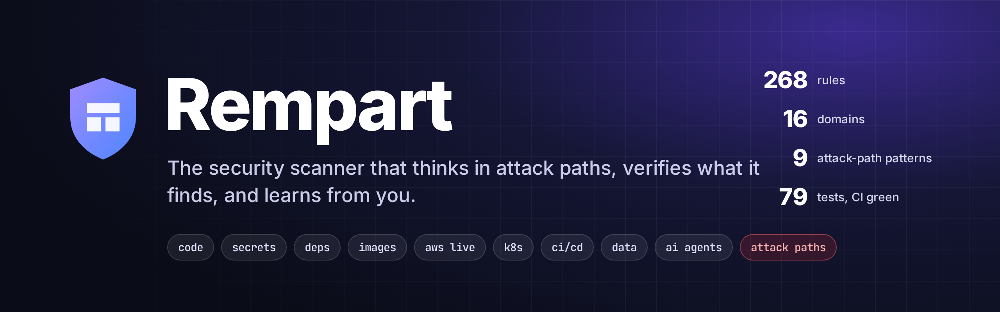
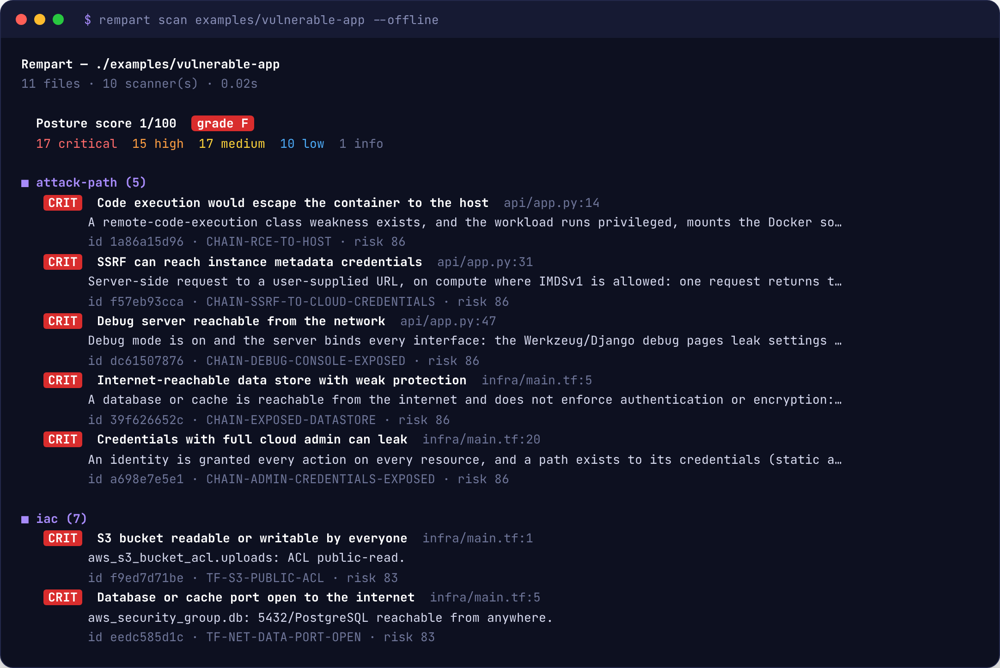
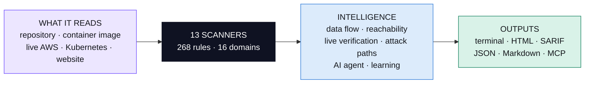
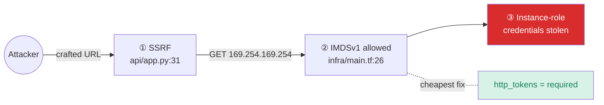
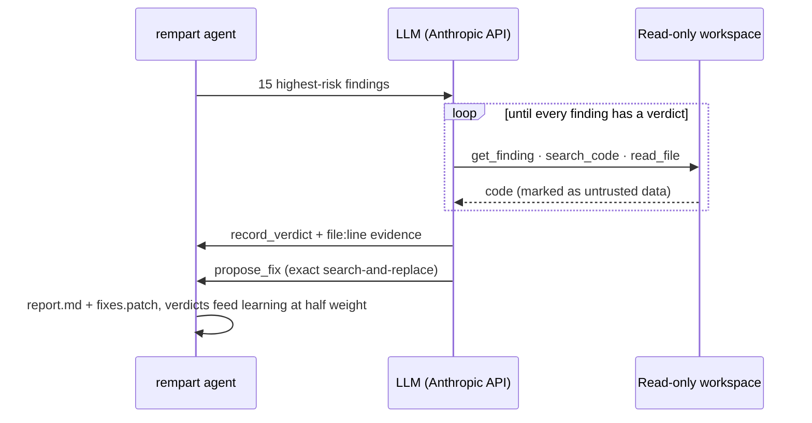

<p align="center">
  
</p>

<p align="center">
  <a href="LICENSE"></a>
  <a href="pyproject.toml"></a>
  <a href="tests"></a>
  <a href="docs/RULES.md"></a>
  <a href="docs/THREAT_CATALOG.md"></a>
  <a href="#-plug-it-into-your-ai-coding-assistant-mcp"></a>
</p>

<p align="center">
  <b>One scan across code, dependencies, container images, your live AWS account and Kubernetes cluster, data stores, CI/CD and AI agents.<br>
  Findings are correlated into attack paths, every result says how it was proven, an AI agent reviews the code behind them, and the tool learns from your triage.</b>
</p>

<p align="center">
  <a href="#-quick-start">Quick start</a> ·
  <a href="#-how-it-thinks">How it thinks</a> ·
  <a href="#-attack-paths">Attack paths</a> ·
  <a href="#-the-ai-verification-agent">AI agent</a> ·
  <a href="#%EF%B8%8F-coverage">Coverage</a> ·
  <a href="docs/THREAT_CATALOG.md">Threat research</a> ·
  <a href="learning/rempart-guide.pdf">Illustrated guide (FR)</a>
</p>

---

<p align="center">
  
  <br><sub>Real output on <code>examples/vulnerable-app</code>: five attack paths found before any single finding is listed.</sub>
</p>

## ✨ Why Rempart

<table>
<tr>
<td width="33%" valign="top">

### 🧭 Thinks in chains
An SSRF is "high". IMDSv1 is "high". Together they are the **2019 Capital One breach**. Rempart joins findings from different domains into **9 attack-path patterns** and names the cheapest link to break.

</td>
<td width="33%" valign="top">

### 🔬 Proves what it says
Every finding carries a **verification level**: pattern, data flow, imported dependency, live observation, live-verified secret, or AI review. CVEs are ranked by **real exploitation** (CISA KEV, FIRST EPSS), not CVSS alone.

</td>
<td width="33%" valign="top">

### 🧠 Gets sharper with use
Mark a result true or false and each rule's precision is recalibrated across all your projects. An **AI agent** reads the code to confirm or reject findings, and it can never close one. Only you can.

</td>
</tr>
</table>

## 🚀 Quick start

```bash
pipx install "rempart[all] @ git+https://github.com/Houssam2510/rempart"   # extras: [aws] boto3 · [ai] Anthropic SDK
```

| You want to… | Run |
|---|---|
| Scan a repository | `rempart scan .` |
| See every domain fire on a demo app | `rempart scan examples/vulnerable-app --offline` |
| Correlate code **and** production | `rempart scan . --aws --image myorg/api:latest` |
| Audit a container image, **no Docker needed** | `rempart image python:3.9-slim` |
| Audit your live AWS account (read-only) | `rempart cloud aws --profile prod` |
| Audit a live Kubernetes cluster | `rempart k8s --context prod` |
| Check whether leaked keys still work | `rempart scan . --verify-secrets` |
| Audit a website you own (passive) | `rempart web https://your-site.example` |
| Let the AI agent verify and fix | `rempart agent .` |
| Gate CI on severity | `rempart scan . --fail-on high -f sarif -o rempart.sarif` |

The core needs only Python 3.11 and PyYAML. No account, no telemetry.

## 🧩 How it thinks



| Layer | Example |
|---|---|
| **Data flow** | `user_id = request.args["id"]` → `q = f"...{user_id}"` → `cur.execute(q)` is flagged even though the sink line looks clean. Python is analysed on its AST per function, including FastAPI parameters. JS/TS variables are tracked from `req.*`, `request.json()` and `searchParams`. |
| **Reachability** | `lodash@4.17.15 … imported by your code` vs `react-server-dom-webpack … transitive, not imported directly` |
| **Live verification** | A GitHub token found in `ci.sh` is checked against `api.github.com/user`. The verdict is `VERIFIED LIVE: GitHub user octo` (CRITICAL) or `revoked` (LOW). It covers 13 providers, including AWS STS through a stdlib SigV4 signer tested byte-for-byte against botocore. |
| **Correlation** | `CODE-SSRF` in `api/app.py` combined with `TF-EC2-IMDSV1` in `infra/main.tf` → `CHAIN-SSRF-TO-CLOUD-CREDENTIALS` |
| **AI agent** | "False positive: `eval` only receives values from the constant `OPS` table; user input selects a key (`app.py:4,8`)." |
| **Learning** | IDOR rule: 35 % → 28 % after one false positive. Wildcard-IAM rule: 85 % → 88 % after one confirmation. |

## 🧨 Attack paths



| Pattern | Links | Real-world reference |
|---|---|---|
| SSRF → cloud credentials | SSRF × IMDSv1 (Terraform or live) | Capital One, 2019 |
| Exposed data store | public port / DB × no auth or encryption | MongoDB wipe-and-ransom waves, 2026 |
| Untrusted CI → release | pwn request / script injection × publish power | TanStack, May 2026 |
| RCE → host | RCE-class bug or KEV CVE × privileged container, socket, hostPath | container escapes |
| Public BaaS table | missing RLS / open Firebase rules × client key in front-end | Supabase / Firebase leaks |
| Debug console exposed | debug mode × bind on 0.0.0.0 | Werkzeug console |
| XSS → session theft | XSS sink × script-readable tokens | session hijacking |
| Admin credentials exposed | `*:*` / AdministratorAccess × key leak path | account takeover |
| Worm propagation | install-time code × publish token | Shai-Hulud, 2025 |

## 🤖 The AI verification agent



```bash
export ANTHROPIC_API_KEY=...
rempart agent . --max-findings 15     # → rempart-agent-report.md + rempart-fixes.patch
rempart agent . --apply               # also write the fixes (review with git diff)
```

It uses the newest Opus-tier model available to your key, or the one set with `--model` / `REMPART_MODEL`. **Safe by construction**:

- 🔒 It reads only the files the scan discovered. There is no tool to execute code, reach the network or write.
- 🧱 Repository content is declared untrusted, a defence against prompt injection planted in comments or READMEs.
- ⏱️ The loop is bounded, and server-side refusal fallback keeps a declined request from aborting the run.
- ⚖️ Its verdicts never delete a finding. They count half in calibration and never override yours.

It is tested against the real Anthropic Python SDK through a mocked HTTP transport, asserting the exact request bodies.

## 🔌 Plug it into your AI coding assistant (MCP)

```json
{ "mcpServers": { "rempart": { "command": "rempart", "args": ["mcp"] } } }
```

Tools: `rempart_scan` · `rempart_finding` · `rempart_triage` · `rempart_web_audit` · `rempart_image_scan` · `rempart_rules`. Your assistant can scan, read details and record verdicts while it writes code.

## 🗺️ Coverage

<details open>
<summary><b>16 domains, mapped to current frameworks</b></summary>

| Domain | Highlights | Frameworks |
|---|---|---|
| 🧬 **Code** | SQL/NoSQL/command/code/template injection, XSS sinks, SSRF, path traversal, open redirect, deserialization, JWT `none`, weak crypto, mass assignment, CORS, uploads, ReDoS, Trojan Source, IDOR queue. Python AST + JS/TS/Svelte/Vue, Go, Java/Kotlin, PHP, Ruby, C#, C/C++ | OWASP A01–A10:2025, CWE Top 25 |
| 🔑 **Secrets** | 25 token formats, private keys, entropy-filtered literals, committed `.env`; live checks for 13 providers | CWE-798 |
| 📦 **Dependencies** | 12 lockfile formats → OSV + KEV + EPSS, malicious releases, typosquats, dependency confusion, install scripts | A03:2025 |
| 🐳 **Images** | Registry pull without Docker, whiteout-aware layers, dpkg/apk via OSV, Python & npm inside images, EOL OS and runtimes, secrets in files/ENV/history | A03/A06:2025 |
| ☁️ **Live AWS** | 28 read-only checks: IAM, S3, security groups (IPv4/IPv6), IMDSv1, EBS, snapshots, RDS, CloudTrail, GuardDuty, Config, KMS, Lambda, EKS, Access Analyzer | CIS AWS Foundations |
| ☸️ **Kubernetes** | Manifests and live clusters: privileged pods, host namespaces, hostPath, capabilities, RBAC escalation, cluster-admin, exposed data services | OWASP K8s Top 10 (2025) |
| 🏗️ **IaC** | Terraform AWS/GCP/Azure incl. `jsonencode()` policies, state committed | CIS, A02/A04:2025 |
| ⚙️ **CI/CD** | Pwn requests, script injection, unpinned actions, cache poisoning, OIDC on untrusted triggers, long-lived publish tokens | OWASP CICD-SEC-1…10 |
| 🗄️ **Data** | Connection-string credentials, DB without TLS, exposed MongoDB/Redis/Postgres/MySQL/Elasticsearch, Supabase RLS, Firebase rules, PII & card numbers, sensitive logs | Québec Law 25, PIPEDA, GDPR, PCI DSS |
| 🧠 **AI & agents** | Unpinned MCP servers, secrets in MCP configs, invisible Unicode in assistant instruction files, LLM output to sinks, shell-executing tools | OWASP LLM 2025, Agentic 2026 |
| 🧹 **Quality & perf** | Fail-open auth, swallowed exceptions, N+1 queries, missing timeouts, unbounded queries, blocking I/O | A10:2025 |
| 🌐 **Web (passive)** | HTTPS, HSTS, CSP, framing, cookies, CORS, banners, legacy TLS, certificate expiry, `security.txt`, cold/warm TTFB | A02/A04/A07:2025 |

The full research is in **[docs/THREAT_CATALOG.md](docs/THREAT_CATALOG.md)**: every threat class, the 2025-2026 incidents behind it, and an honest list of what static analysis cannot see. All rules: [docs/RULES.md](docs/RULES.md).

</details>

<details>
<summary><b>Ranking, score and learning formulas</b></summary>

```
risk = severity_weight × (0.5 + confidence / 2)
if EPSS is known:      risk = max(risk, 0.6 × risk + 40 × EPSS)
if CVE is in CISA KEV: risk = max(risk, 95)                 # fact beats prediction
posture score = 100 × exp(−penalty / 120)                   # repeats of one rule weigh 1, ½, ⅓…
precision(rule) = (TP + a) / (TP + FP + a + b)              # Beta prior from the rule's declared confidence
```

Distribution CVEs with no fix in your release that are over three years old are kept but ranked LOW unless KEV-listed. Rules with ≥ 5 false positives and < 25 % precision drop one severity level.

</details>

<details>
<summary><b>CI, configuration and output formats</b></summary>

```yaml
- uses: Houssam2510/rempart@<commit-sha>
  with: { fail-on: high }
- uses: github/codeql-action/upload-sarif@24c54180a607b1449ed407dd24f251e4e9147c8d # v4.38.3
  with: { sarif_file: rempart.sarif }
```

The formats are `console` · `json` · `sarif` · `md` · `html` (a self-contained, filterable report). Configure with `.rempart.toml` (`exclude`, `disable`, `[severity]` overrides, `fail_on`), or inline with `# rempart:ignore[RULE-ID]`.

</details>

## 📏 Measured, not claimed

| Target | Result |
|---|---|
| Production SvelteKit SaaS (350 files, 426 packages) | All findings reviewed. Dogfooding removed false positives (language cookie, escaped JSON-LD, bounded regexes, `RegExp.exec()`) and surfaced real advisories in transitive framework dependencies. |
| [cspm-lite](https://github.com/Houssam2510/cspm-lite) vulnerable AWS lab | **9 / 9** planted misconfigurations + 2 attack paths |
| `python:3.9-slim` (live pull, 6 s) | Debian 13, 64 packages, EOL runtime flagged, 176 OS CVEs ranked fixable-first |
| AWS checks | **28 / 28** validated against the official AWS service models (botocore Stubber) |
| Rempart on itself | Grade **A**. CI fails on any high finding, and 0 tests are skipped in CI. |

## ⚠️ Limits, stated plainly

- **Data flow stays inside one function.** Values laundered across functions are missed. The agent covers part of that gap.
- **Attack paths come from co-occurrence, not a resource graph.** Links may concern different resources, so each chain names them for you to check.
- **Logic flaws** (IDOR, business-flow abuse) are a review queue, not verdicts.
- **Images**: RPM, Go binaries and JARs are not parsed yet.
- **Live cloud**: AWS only so far.
- **The web mode is passive.** It is not a penetration test.

## 🛣️ Roadmap

`baseline mode for PRs` · `git-history secrets` · `resource-level attack graph` · `inter-procedural data flow` · `live GCP & Azure` · `RPM / Go / JAR images` · `release-cooldown policy` · `agent evaluation corpus` · `PyPI release` → [docs/ROADMAP.md](docs/ROADMAP.md)

## 📚 Learn it

- **[learning/rempart-guide.pdf](learning/rempart-guide.pdf)**: a 16-page illustrated guide in French, one concept per page with real examples.
- [docs/ARCHITECTURE.md](docs/ARCHITECTURE.md) · [docs/THREAT_CATALOG.md](docs/THREAT_CATALOG.md) · [SECURITY.md](SECURITY.md) (what is sent where).

---

<p align="center"><sub>Built by <a href="https://github.com/Houssam2510">Houssam Nadir</a> · Polytechnique Montréal · MIT license<br>
Related: <a href="https://github.com/Houssam2510/cspm-lite">cspm-lite</a> and <a href="https://github.com/Houssam2510/triage">triage</a>, the earlier prototypes whose live-AWS audit and KEV/EPSS prioritisation now live inside Rempart.</sub></p>
